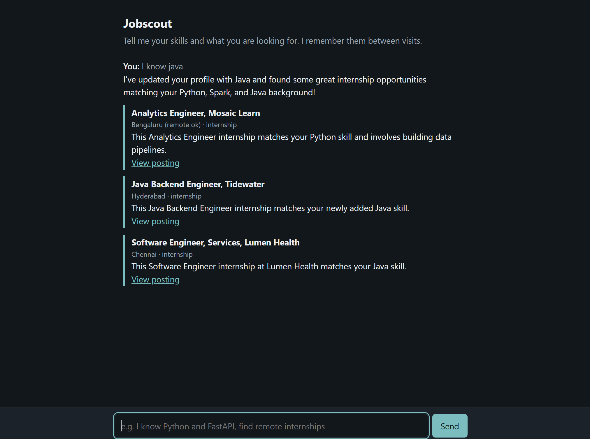
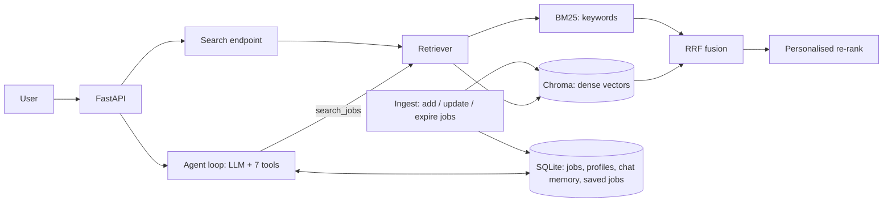

# Jobscout

**An AI job-search agent for students and early-career people: hybrid semantic search over a changing jobs index, personalised ranking, a tool-using LLM agent with persistent memory, and an eval harness that measures both retrieval and agent behaviour.**

**Live demo:** https://jobscout-ayuu.onrender.com (free tier: the first load can take about a minute to wake)



## What it does

- You tell it your skills and what you want ("I know Python and FastAPI, find remote internships"). It **remembers your profile** between visits.
- It searches a jobs index with **hybrid retrieval** (embeddings plus keyword search), **filters** by location, remote and job type, and **re-ranks for you** using your skills and preferences.
- Every recommendation is **structured, validated and explained**: which of your skills matched, whether it's remote, how recent it is.
- Jobs can be added, updated and expired at any time without rebuilding the index.

## Architecture



## What to look at

| If you care about | Look at |
|---|---|
| Retrieval, ranking, personalisation | `app/retrieval.py`: dense + BM25 → Reciprocal Rank Fusion → re-rank with a per-result score breakdown |
| A search index that keeps changing | `app/index.py`: hash-diff sync that re-embeds only changed text, does cheap metadata updates, and prunes expired jobs |
| LLM agents, tool use, memory | `app/agent.py`: tool-use loop, long-term profile memory, short-term chat memory |
| Structured outputs and guardrails | `present_recommendations` is schema-validated and every job id must have come from a tool result that turn, so it cannot recommend jobs that do not exist |
| Evaluating LLM and retrieval quality | `evals/`: Recall@k, MRR, nDCG, latency per pipeline stage, plus behavioural agent tests |
| Provider portability | `app/llm.py`: runs on Gemini, Groq, Cerebras, OpenRouter, Mistral, Ollama or Claude with one env var |

## Results

Retrieval quality per pipeline stage (`python -m evals.run_retrieval_eval`):

| Pipeline stage | Recall@10 | MRR | nDCG@10 | p50 latency |
|---|---|---|---|---|
| BM25 only | 0.621 | 0.845 | 0.741 | 0.5 ms |
| Dense only | 0.664 | 0.868 | 0.768 | 6.9 ms |
| Hybrid (RRF) | 0.718 | 0.925 | 0.824 | 6.7 ms |
| Hybrid + personalised | 0.720 | 0.944 | 0.834 | 7.6 ms |

Each stage improves on the last: hybrid fusion lifts nDCG@10 from 0.768 (dense only) to 0.824, and personalisation adds a smaller gain on the ambiguous queries where a user profile matters.

**Read this as a pipeline validation, not a benchmark.** The numbers come from 120 synthetic postings and 12 queries whose relevance labels are generated, using `BAAI/bge-small-en-v1.5` embeddings. The ranking trend is meaningful; the absolute values are not. Re-running on real postings with hand-labelled queries is the next step (see below). Behavioural checks for the agent (tool routing, filter extraction, resistance to injected instructions, no hallucinated job ids) run with `python -m evals.run_agent_eval`.

## Engineering decisions

- **Hybrid retrieval with RRF.** Embeddings handle paraphrase ("agents that call tools" ≈ "AI Agents Engineer"); BM25 handles exact skill names and acronyms. Reciprocal Rank Fusion merges ranks, so no score calibration is needed.
- **Explainable personalisation.** The final score is a fixed blend: 0.60 relevance, 0.20 skill overlap, 0.12 preference match, 0.08 recency. Every result returns its breakdown, so ranking is debuggable rather than a black box.
- **Incremental indexing.** Each job carries two hashes (text vs all fields), so editing a salary doesn't pay for a new embedding. One vector collection per embedding model means switching models never mixes vector spaces. Chroma can always be rebuilt from SQLite.
- **Guardrails on the agent.** Job text is treated as untrusted data (prompt-injection defence), tool errors go back to the model instead of crashing, recommended ids are verified against tool results, and the loop has a hard step cap.
- **Provider-agnostic LLM layer.** The agent is written once against a single message format; an adapter converts to any OpenAI-compatible endpoint, so the project runs on free tiers.

## Tech stack

Python · FastAPI · Pydantic · ChromaDB · BM25 (rank-bm25) · fastembed (ONNX embeddings) · SQLite · Gemini / Claude / OpenAI-compatible LLMs · Docker · pytest

## Run it locally

```bash
git clone https://github.com/shamukhi/jobscout && cd jobscout
python -m venv .venv && source .venv/bin/activate      # Windows: .\.venv\Scripts\Activate.ps1
pip install -r requirements-dev.txt
pytest -q                                                # 22 tests, no network or API key needed
export GEMINI_API_KEY=...                                # free key from Google AI Studio
uvicorn app.main:app                                     # http://localhost:8000
```

Search, indexing and the retrieval eval work without any API key; only `/chat` needs one. Full setup, provider options, real-data ingestion and deployment are in [docs/SETUP.md](docs/SETUP.md).

## Project layout

```
app/        agent.py  retrieval.py  index.py  llm.py  store.py  models.py  main.py
evals/      retrieval eval, agent eval, labelled queries
scripts/    sample-data generator, CSV ingest for real postings
tests/      22 tests: sync, filters, ranking, agent loop, LLM adapter, API
static/     minimal chat UI
```

## Limitations and next steps

- Free-tier hosting resets user profiles and chat memory when the instance restarts; the job index reloads automatically. A persistent disk or Postgres would fix this.
- `/chat` has no authentication or rate limiting yet.
- BM25 is rebuilt in memory when jobs change, which is fine for tens of thousands of jobs. Beyond that, move to SQLite FTS5 or Elasticsearch.
- Next: re-run the evals on a real postings dataset with hand-labelled queries, then a cross-encoder or LLM re-ranker on the top 20, measured in the same eval table, and an LLM-as-judge check that each recommendation reason is supported by the job text.
